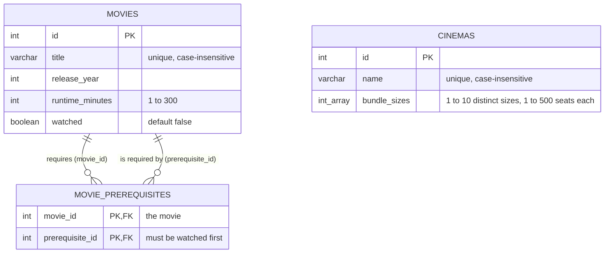

# Doomsday Ready

A small full-stack app that helps MCU fans plan their rewatch before *Avengers: Doomsday* and book an opening-night watch party.

- **Backend:** FastAPI
- **Database:** Supabase 
- **Frontend:** React + TypeScript 
- **Tests:** pytest (45 tests, including every example table in the brief)

## Quick start

### Option A: Docker Compose (one command)

```bash
cp .env.example .env        # optional, see "Using Supabase" below
docker compose up --build
```

Then open:

| What | URL |
|---|---|
| App | http://localhost:3000 |
| API | http://localhost:8000/api |
| Interactive API docs | http://localhost:8000/docs |

With no `DATABASE_URL` set, Compose uses a bundled local Postgres container and loads the sample data from the brief (8 movies, 4 cinemas) so there is something to click on straight away.

### Option B: run the pieces yourself

```bash
# Backend (terminal 1)
cd backend
python -m venv .venv && source .venv/bin/activate     # Windows: .venv\Scripts\activate
pip install -r requirements.txt
SEED_SAMPLE_DATA=true uvicorn app.main:app --reload    # uses SQLite unless DATABASE_URL is set

# Frontend (terminal 2)
cd frontend
npm install
npm run dev                                            # http://localhost:5173, proxies /api to :8000
```

### Run the tests

```bash
cd backend
pytest
```

For the full Docker explanation, a reviewer checklist and cloud deployment steps (Supabase + Render + Vercel), see **[DEPLOYMENT.md](DEPLOYMENT.md)**.

## Using Supabase

1. Create a project at [supabase.com](https://supabase.com).
2. (Optional) open **SQL Editor** and run [`supabase/schema.sql`](supabase/schema.sql). The API also creates the tables itself on startup, so this step only matters if you want the tables to exist (with row level security enabled) before the app first runs.
3. Go to **Project Settings -> Database -> Connection string -> URI** and copy it.
4. Put it in `.env` (root folder), replacing the password placeholder:

   ```
   DATABASE_URL=postgresql://postgres:<password>@db.<project-ref>.supabase.co:5432/postgres
   ```

5. Start the app as above. `postgres://` and `postgresql://` URLs are both accepted.

> If the direct connection fails from your machine or from Docker (the direct host can be IPv6-only), use the **Session pooler** connection string from the same Supabase page instead.

The backend connects straight to Postgres with the database password, not through Supabase's REST API. `schema.sql` turns on row level security with no policies so the tables cannot be read or written through the public `anon` key.

## Data model



Movies form a directed graph: each row in `movie_prerequisites` is an edge *movie -> prerequisite*. A database `CHECK` stops a movie pointing at itself, and the API rejects longer cycles. Cinemas are independent of movies; a cinema's bundle sizes live in a single `integer[]` column (JSON on SQLite for tests).

## API

All endpoints live under `/api`. Errors look like `{"error": "CODE", "message": "..."}`.

| Method and path | Purpose |
|---|---|
| `POST /api/movies` | Create a movie |
| `GET /api/movies` | List movies |
| `PATCH /api/movies/{id}` | Update a movie, including `watched` and `prerequisite_ids` |
| `GET /api/movies/{id}/rewatch-order` | Rewatch order (feature 1) |
| `POST /api/cinemas` | Create a cinema |
| `GET /api/cinemas` | List cinemas |
| `GET /api/cinemas/{id}/booking?groupSize=6` | Booking quote (feature 2) |
| `GET /api/health` | Health check (extra) |

Example movie body: `{"title": "Iron Man", "release_year": 2008, "runtime_minutes": 126, "prerequisite_ids": [], "watched": false}`

| Status | `error` code | When |
|---|---|---|
| 409 | `CIRCULAR_DEPENDENCY` | A PATCH would make a movie depend on itself, directly or through other movies |
| 409 | `DUPLICATE_TITLE` / `DUPLICATE_NAME` | Movie title or cinema name already exists |
| 422 | `VALIDATION_ERROR` | Bad input (runtime outside 1-300, group size outside 1-10,000, bundle sizes outside 1-500, and so on) |
| 422 | `UNKNOWN_PREREQUISITE` | A prerequisite id does not exist |
| 404 | `MOVIE_NOT_FOUND` / `CINEMA_NOT_FOUND` | Unknown id |

## How the two algorithms work

Both are written by hand in [`backend/app/algorithms/`](backend/app/algorithms) with no graph or DP libraries.

### Feature 1: circular dependencies and rewatch order

**Cycle check** ([`cycle.py`](backend/app/algorithms/cycle.py)). Giving movie `M` new prerequisites creates a cycle exactly when `M` can be reached by following prerequisites from one of the new ones (or when `M` is one of them). An iterative depth-first search walks the existing graph from the new prerequisites and returns `True` the moment it meets `M`. The movie's old prerequisites are never explored, because they are being replaced. A rejected update changes nothing.

**Rewatch order** ([`rewatch.py`](backend/app/algorithms/rewatch.py)). An iterative depth-first search from the target emits each movie in **post-order**, meaning only after all of its own prerequisites were emitted. That is a valid topological order by construction. Movies reachable through several paths (diamonds) appear once, and the target itself is left out. A three-colour marking also detects a cycle in corrupt data and raises instead of looping forever. Iterative (not recursive) so a very long franchise chain cannot overflow the stack; a unit test uses a chain of 20,000 movies.

The API then adds `total_count`, `watched_count` and `remaining_runtime_minutes` (sum of runtimes of the unwatched movies).

Complexity: O(V + E) for both.

### Feature 2: booking quote

[`booking.py`](backend/app/algorithms/booking.py) is the minimum coin change problem solved with bottom-up dynamic programming:

```
best[0] = 0
best[t] = 1 + min(best[t - s]) for every bundle size s <= t    (unreachable if none)
```

`last[t]` remembers the size used to reach `t`, so walking back from the group size to 0 gives how many of each bundle to buy. If `best[group]` is unreachable, the API answers `possible: false`. A greedy approach would be wrong here (for bundles 1, 3, 4 and 6 seats it picks 4+1+1 = 3 bundles; the right answer is 3+3 = 2).

Complexity: O(group size x number of bundle sizes), at most 10,000 x 10 = 100,000 steps.

## Assumptions and choices

The brief left these open, so here is what I decided:

- **Prerequisites are sent as movie ids** (`prerequisite_ids`), not titles. Unknown ids are rejected with 422.
- **Duplicates:** titles and cinema names are unique ignoring upper/lower case and surrounding spaces. Duplicate prerequisite ids in one request are merged. Duplicate bundle sizes in one cinema are rejected with 422, since the brief says "different bundle sizes". Bundle sizes are stored sorted.
- **Release year** must be between 1888 and 2100. The brief gave no range.
- **Cycle check on create:** a brand-new movie has no id yet, so nothing can depend on it and no cycle is possible. The check runs on PATCH, where it can happen.
- **Deleting movies/cinemas** is not part of the brief, so there is no delete endpoint.
- **Booking ties:** when several combinations use the same minimum number of bundles, one is returned (the brief's examples each have a single answer). The quote lists larger bundles first.
- **"Not possible"** is a normal `200` response with `possible: false`, not an error, because it is a valid answer to the question.
- **Group size** outside 1-10,000 returns 422.
- **Rewatch order** between movies that are not connected by any prerequisite is by ascending id, so results are repeatable.
- **Sample data** is the brief's table. Runtimes and years are approximate, and the runtime of *Avengers: Doomsday* (150) is a placeholder because it is unreleased. Seeding only happens when `SEED_SAMPLE_DATA=true` and the movies table is empty.
- **Frontend extras:** the Rewatch Plan view lets you tick movies as watched too, and the Booking view has a small form to add a cinema, so the app is usable from an empty database.

## How I used AI

> **Edit this section so it describes what you actually did before you submit.**

I used Claude (Anthropic) as a coding assistant. I used it to:

- read the brief and compare technology options, then choose the stack
- generate the first version of the FastAPI app, database models, React views, Dockerfiles and this README
- write the unit and API tests from the brief's example tables

I reviewed the code, ran the tests, and I can explain every part, in particular the two algorithms in `backend/app/algorithms/`.

## Project layout

```
backend/
  app/
    algorithms/     cycle.py, rewatch.py, booking.py   (hand-written)
    routers/        movies.py, cinemas.py
    models.py  schemas.py  errors.py  database.py  config.py  seed.py  main.py
  tests/            test_algorithms.py, test_api.py
frontend/src/
  views/            MoviesView, RewatchView, BookingView
  api.ts  types.ts  App.tsx  styles.css
supabase/schema.sql
docker-compose.yml
```
