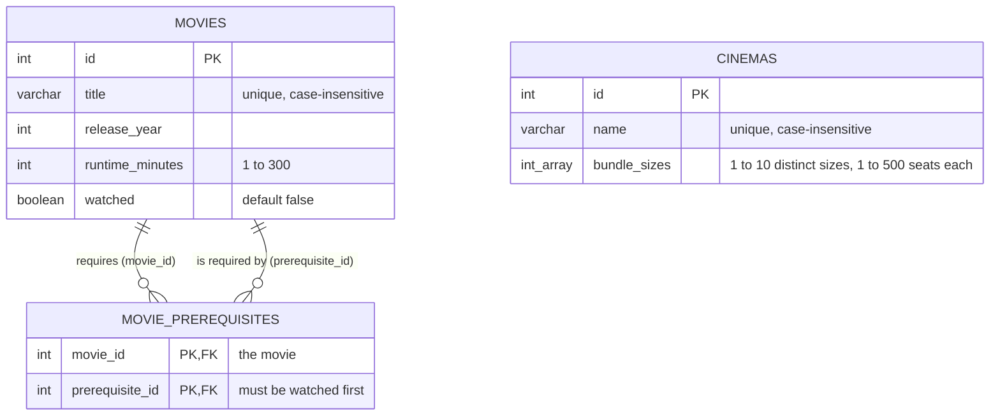

# Doomsday Ready

A full-stack app for MCU fans: plan the rewatch before *Avengers: Doomsday*, and book an opening-night watch party with the fewest seat bundles.

**Live app:** https://doomday-rho.vercel.app
**API docs:** https://dooms-day-im0u.onrender.com/docs

The backend is on Render's free plan, which sleeps when idle, so the first request can take up to a minute.

## Tech stack

| Layer | Technology |
|---|---|
| Frontend | React, TypeScript, Vite |
| Backend | FastAPI (Python), SQLAlchemy |
| Database | Supabase (PostgreSQL) |
| Containers | Docker Compose |
| Hosting | Vercel (frontend), Render (backend, Docker), Supabase (database) |
| Tests | pytest (45 tests) |

## Run it with Docker (one command)

Requires Docker Desktop (or Docker Engine with the Compose plugin).

```bash
git clone <repository-url>
cd doomsday-ready
docker compose up --build
```

Then open http://localhost:3000 (API docs at http://localhost:8000/docs).

With no configuration, Compose starts its own Postgres container and loads the sample data (8 movies and 4 cinemas), so the app works straight away.

### Using Supabase as the database

1. Create a project at [supabase.com](https://supabase.com).
2. Open **SQL Editor** and run [`supabase/schema.sql`](supabase/schema.sql). The API also creates missing tables when it starts.
3. Click **Connect** and copy the **Session pooler** connection string. Use the pooler, not the direct host, because the direct host can be IPv6-only and fail inside Docker or on hosting platforms.
4. Copy `.env.example` to `.env` and set:

   ```
   DATABASE_URL=postgresql://postgres.<project-ref>:<password>@<pooler-host>:5432/postgres
   SEED_SAMPLE_DATA=true
   ```

5. Run `docker compose up --build` again. The backend now uses Supabase. Check the **Table Editor** in Supabase to see the data.

`.env` holds your password and is git-ignored. Never commit it.

## Run without Docker

You need Python 3.11+, Node 18+ and a `DATABASE_URL` pointing at Postgres (for example Supabase, as above).

```bash
# Backend (terminal 1)
cd backend
python -m venv .venv && source .venv/bin/activate    # Windows: .venv\Scripts\activate
pip install -r requirements.txt
export DATABASE_URL="postgresql://..."               # Windows PowerShell: $env:DATABASE_URL="postgresql://..."
export SEED_SAMPLE_DATA=true
uvicorn app.main:app --reload                        # http://localhost:8000

# Frontend (terminal 2)
cd frontend
npm install
npm run dev                                          # http://localhost:5173, proxies /api to :8000
```

### Tests

```bash
cd backend
pytest
```

The 45 tests cover both algorithms and every API endpoint, including each example from the brief. They run against a temporary in-memory database, so they need no setup.

## Deployment

See [DEPLOYMENT.md](DEPLOYMENT.md) for the Docker setup, a reviewer checklist and the Supabase + Render + Vercel steps. In short:

- **Database:** Supabase (Session pooler connection string).
- **Backend:** Render Web Service built from `backend/Dockerfile`, with `DATABASE_URL`, `SEED_SAMPLE_DATA` and `CORS_ORIGINS` set.
- **Frontend:** Vercel project with root directory `frontend` and `VITE_API_URL=https://<backend>/api`.

## Data model



Movies form a directed graph: each row in `movie_prerequisites` is an edge from a movie to one of its prerequisites. A database `CHECK` constraint stops a movie from requiring itself, and the API rejects longer cycles. Cinemas are independent of movies; a cinema's bundle sizes are stored in a single Postgres `integer[]` column.

## API

All endpoints are under `/api`. Errors have the form `{"error": "CODE", "message": "..."}`.

| Method and path | Purpose |
|---|---|
| `POST /api/movies` | Create a movie |
| `GET /api/movies` | List movies |
| `PATCH /api/movies/{id}` | Update a movie, including `watched` and `prerequisite_ids` |
| `GET /api/movies/{id}/rewatch-order` | Rewatch order |
| `POST /api/cinemas` | Create a cinema |
| `GET /api/cinemas` | List cinemas |
| `GET /api/cinemas/{id}/booking?groupSize=6` | Booking quote |
| `GET /api/health` | Health check |

| Status | `error` code | When |
|---|---|---|
| 409 | `CIRCULAR_DEPENDENCY` | An update would make a movie require itself, directly or through other movies |
| 409 | `DUPLICATE_TITLE` / `DUPLICATE_NAME` | Movie title or cinema name already exists |
| 422 | `VALIDATION_ERROR` | Invalid input (runtime outside 1-300, group size outside 1-10,000, bundle sizes outside 1-500, and so on) |
| 422 | `UNKNOWN_PREREQUISITE` | A prerequisite id does not exist |
| 404 | `MOVIE_NOT_FOUND` / `CINEMA_NOT_FOUND` | Unknown id |

## How the algorithms work

Both are written by hand in [`backend/app/algorithms/`](backend/app/algorithms), with no graph or dynamic-programming libraries.

### Rewatch order and cycle detection

**Cycle check** (`cycle.py`). Giving movie `M` new prerequisites creates a cycle exactly when `M` can be reached by following prerequisites from one of the new ones (or when `M` is one of them). An iterative depth-first search walks the existing graph from the new prerequisites and returns as soon as it meets `M`. The movie's old prerequisites are skipped, because they are being replaced. A rejected update changes nothing.

**Rewatch order** (`rewatch.py`). An iterative depth-first search from the target emits each movie in post-order, which means only after all of its own prerequisites. That is a valid topological order. A movie reachable through several paths appears once, and the target itself is left out. A three-state marking (unvisited, in progress, finished) detects a cycle in corrupt data instead of looping forever. The search is iterative, so a very long chain cannot overflow the stack; a test uses a chain of 20,000 movies.

The API also returns `total_count`, `watched_count` and `remaining_runtime_minutes`.

Complexity: O(V + E).

### Booking quote

`booking.py` solves minimum coin change with bottom-up dynamic programming:

```
best[0] = 0
best[t] = 1 + min(best[t - s]) for every bundle size s <= t
```

`last[t]` stores the bundle size used to reach `t`, so walking back from the group size to 0 gives the count of each bundle. If the group size cannot be reached, the API answers `possible: false`. A greedy approach is wrong here: for bundles of 1, 3 and 4 and a group of 6, greedy picks 4+1+1 (3 bundles) while the best is 3+3 (2 bundles).

Complexity: O(group size x number of bundle sizes), at most 10,000 x 10 = 100,000 steps.

## Assumptions and design decisions

The brief left these open:

- **Prerequisites are sent as movie ids** (`prerequisite_ids`). Unknown ids are rejected with 422.
- **Uniqueness:** titles and cinema names are unique ignoring case and surrounding spaces. Duplicate prerequisite ids in one request are merged. Duplicate bundle sizes in one cinema are rejected with 422, since the brief asks for different sizes. Bundle sizes are stored sorted.
- **Release year** must be between 1888 and 2100, since no range was given.
- **Cycle check on create:** a new movie has no id yet, so nothing can depend on it. The check runs on update, where a cycle can appear.
- **No delete endpoints**, because the brief does not require them.
- **Booking ties:** when several combinations use the same minimum number of bundles, one is returned. Larger bundles are listed first.
- **"Not possible"** is a normal `200` response with `possible: false`, because it is a valid answer.
- **Group size** outside 1-10,000 returns 422.
- **Rewatch order** for movies not connected to each other is by ascending id, so results are repeatable.
- **Sample data** comes from the brief's example. Runtimes and years are approximate, and the runtime of *Avengers: Doomsday* (150) is a placeholder because it is unreleased. Seeding runs only when `SEED_SAMPLE_DATA=true` and the movies table is empty.
- **Frontend extras:** the Rewatch Plan page lets you tick movies as watched, and the Booking page has a form to add a cinema, so the app is usable from an empty database.

## How I used AI

I used Claude (Anthropic) as an AI assistant during this project:

- **Planning:** to read the brief and compare stack options before I chose FastAPI, Supabase and React.
- **Code:** it generated the first version of the FastAPI backend, the React views, the Dockerfiles and the tests, including tests built from the brief's example tables.
- **Documentation:** it drafted the first version of this README and DEPLOYMENT.md.

What I did myself:

- Created the Supabase project, wrote the connection string and deployed to Render and Vercel.
- Debugged the real deployment problems: a wrong Supabase pooler username and host, a missing `/api` in the frontend API URL, and a CORS origin mismatch.
- Ran the tests and the app and checked the behaviour against the brief.
- Reviewed the two algorithms in `backend/app/algorithms/` and I can explain how they work.

## Project layout

```
backend/
  app/
    algorithms/     cycle.py, rewatch.py, booking.py
    routers/        movies.py, cinemas.py
    models.py  schemas.py  errors.py  database.py  config.py  seed.py  main.py
  tests/            test_algorithms.py, test_api.py
frontend/src/
  views/            MoviesView, RewatchView, BookingView
  api.ts  types.ts  App.tsx  styles.css
supabase/schema.sql
docker-compose.yml
DEPLOYMENT.md
```
